# Secure Student API

A REST API built with Django REST Framework that uses JWT authentication and role-based permissions to manage student records.

## Technologies Used

- Python
- Django
- Django REST Framework
- Simple JWT
- SQLite
- Postman

## Features

- JWT authentication
- Admin, Faculty, and Student roles
- Student record management
- Role-based access permissions
- Student record ownership restrictions

## Installation

### 1. Clone the Repository

```bash
git clone https://github.com/rocrisjoygerongano/secure_student_api.git
cd secure_student_api
```

### 2. Create and Activate Virtual Environment

```bash
python -m venv venv
```

Windows PowerShell:

```powershell
.\venv\Scripts\Activate.ps1
```

### 3. Install Dependencies

```bash
pip install -r requirements.txt
```

### 4. Configure Environment Variables

Create a `.env` file in the project root (the same folder as `manage.py`).

Add your own Django secret key:

```env
DJANGO_SECRET_KEY=your-generated-secret-key-here
```

Do not upload your `.env` file to GitHub.

### 5. Apply Migrations

```bash
python manage.py migrate
```

### 6. Create Admin Account

```bash
python manage.py createsuperuser
```

### 7. Run the Server

```bash
python manage.py runserver
```

API base URL:

```text
http://127.0.0.1:8000/
```

## API Endpoints

| Method | Endpoint | Description |
|---|---|---|
| POST | `/api/token/` | Obtain JWT tokens |
| POST | `/api/token/refresh/` | Refresh access token |
| GET | `/api/student-records/` | View student records |
| POST | `/api/student-records/` | Create student record |
| GET | `/api/student-records/{id}/` | View a specific record |
| PUT | `/api/student-records/{id}/` | Update a record |
| PATCH | `/api/student-records/{id}/` | Partially update a record |
| DELETE | `/api/student-records/{id}/` | Delete a record |

## User Roles

| Permission | Admin | Faculty | Student |
|---|---|---|---|
| View all records | Yes | Yes | No |
| View own records | Yes | Yes | Yes |
| Create records | Yes | No | No |
| Update records | Yes | Yes | No |
| Delete records | Yes | No | No |

## Screenshots

### JWT Authentication
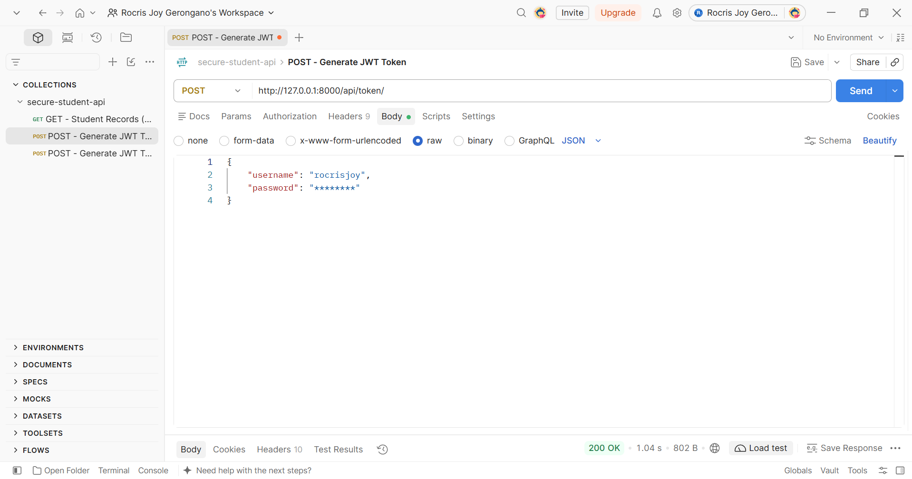

### Admin Access
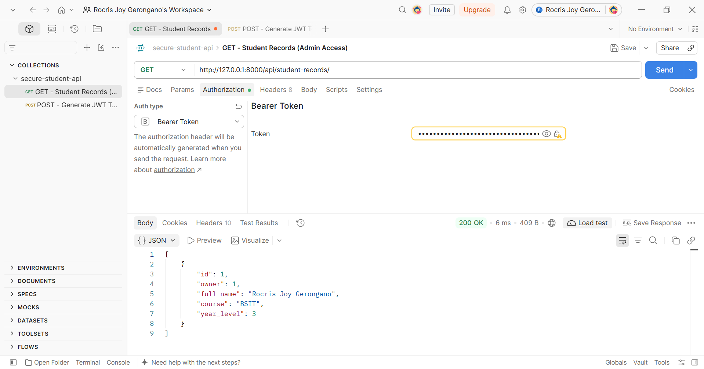

### Admin Create Record
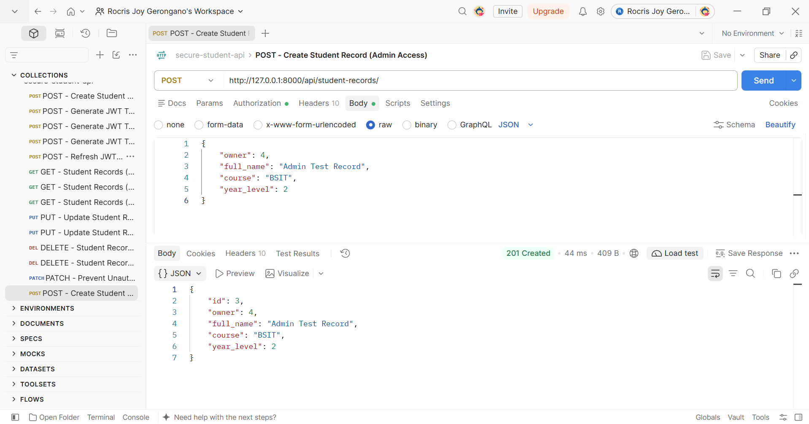

### Admin Delete Record
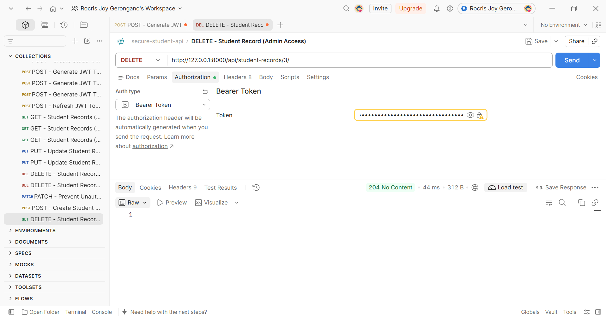

### Faculty Access
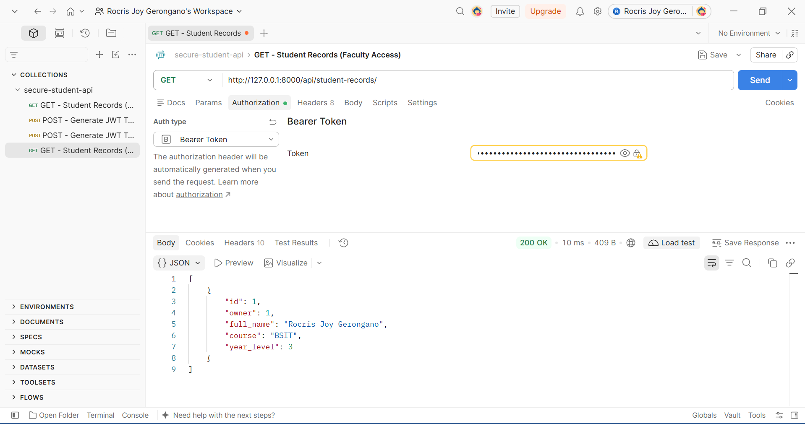

### Faculty Update Record
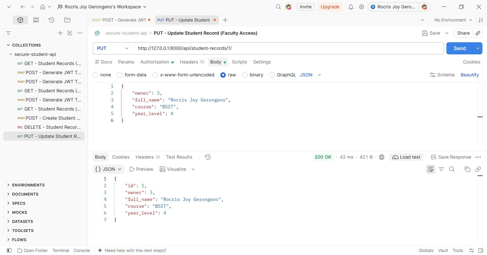

### Student Own Records
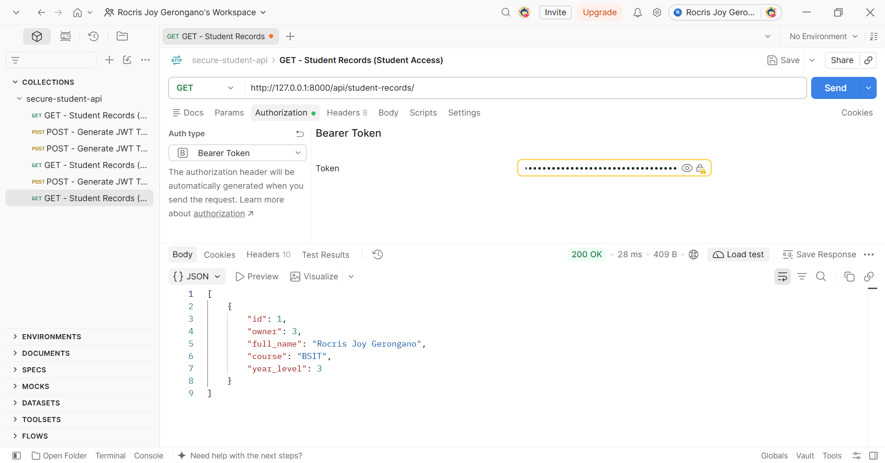

### Student Access Denied
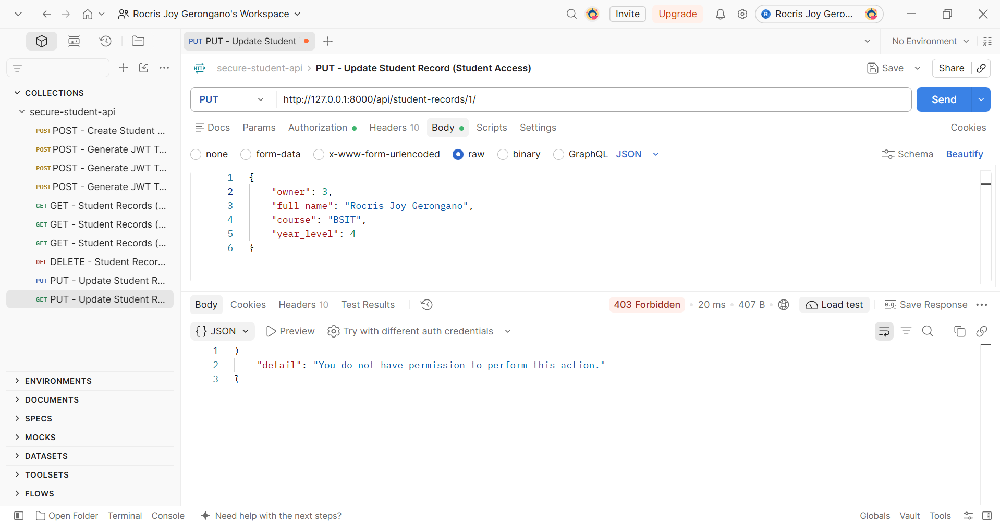

### Student Record Isolation
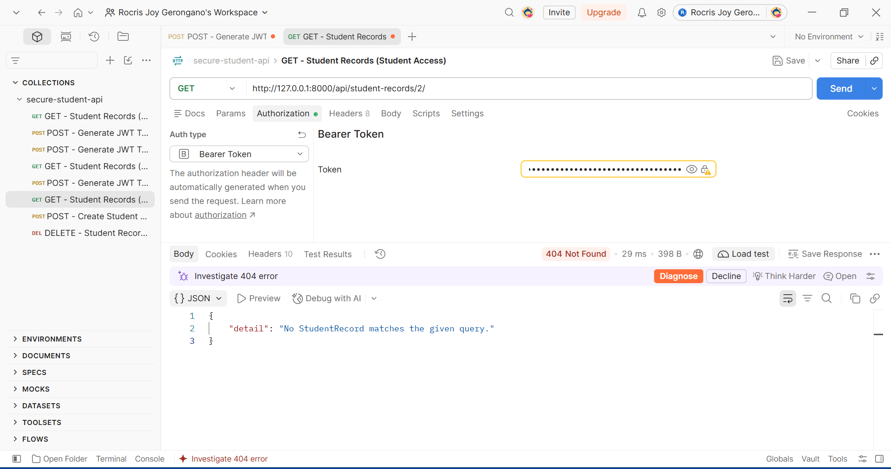

### Owner Protection
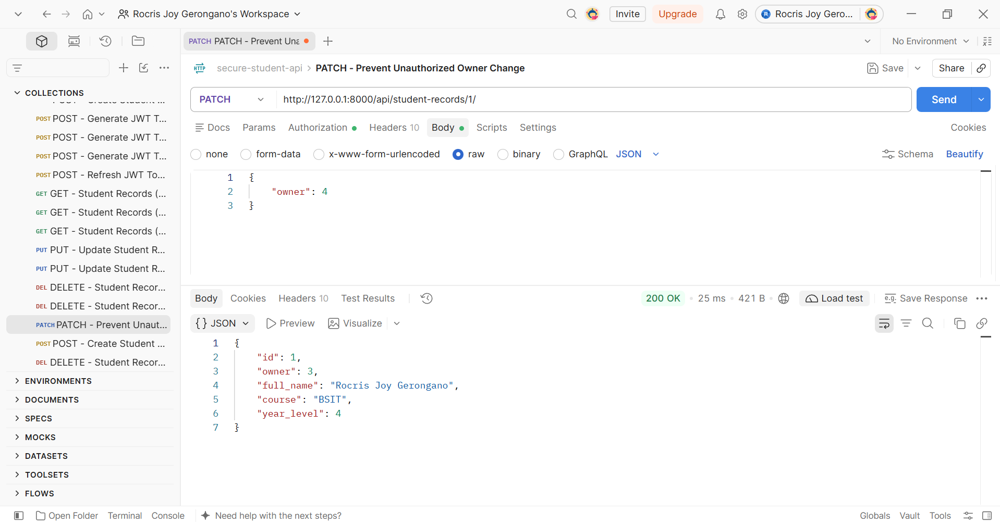

### Django Admin Panel
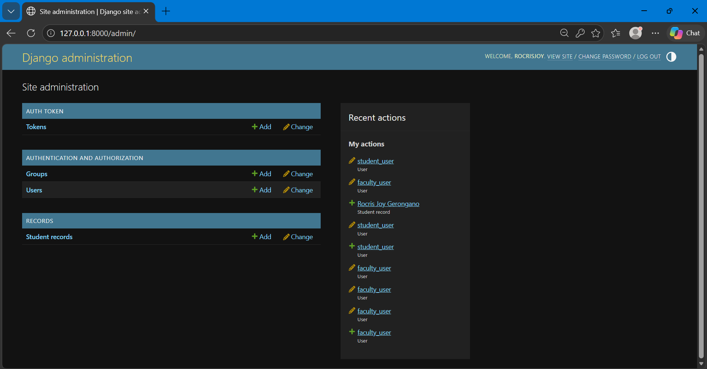