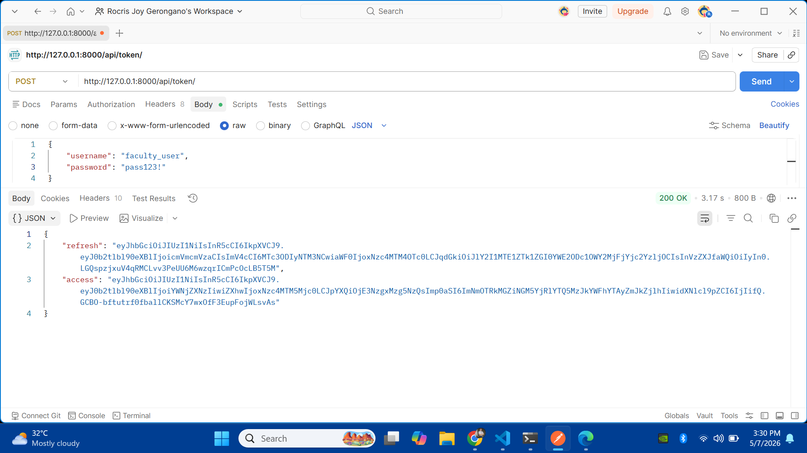
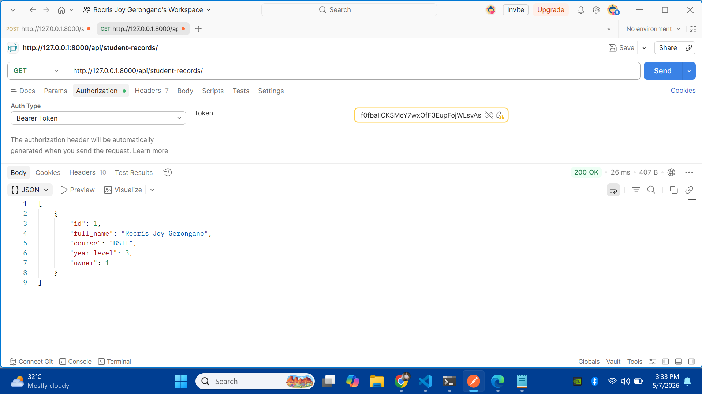
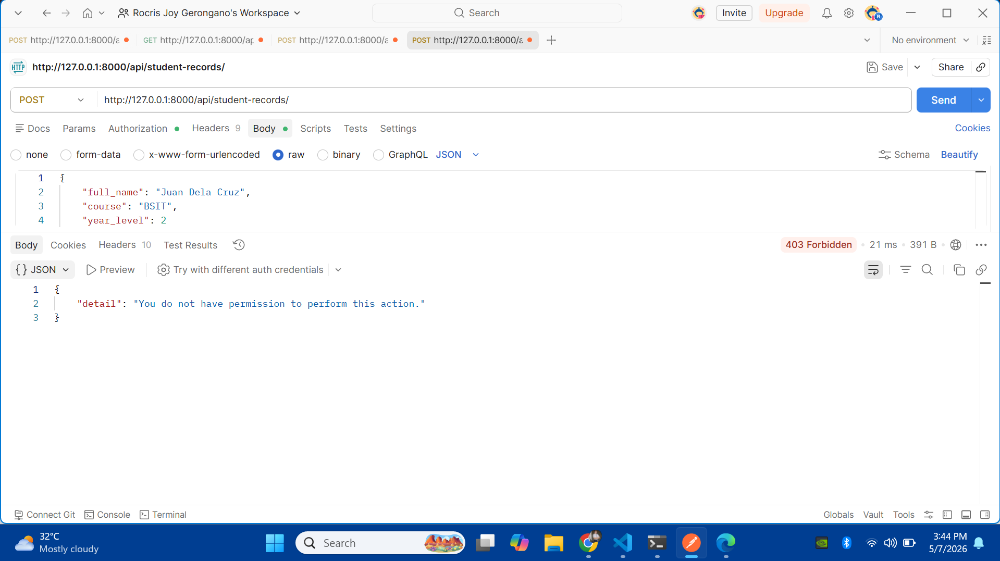
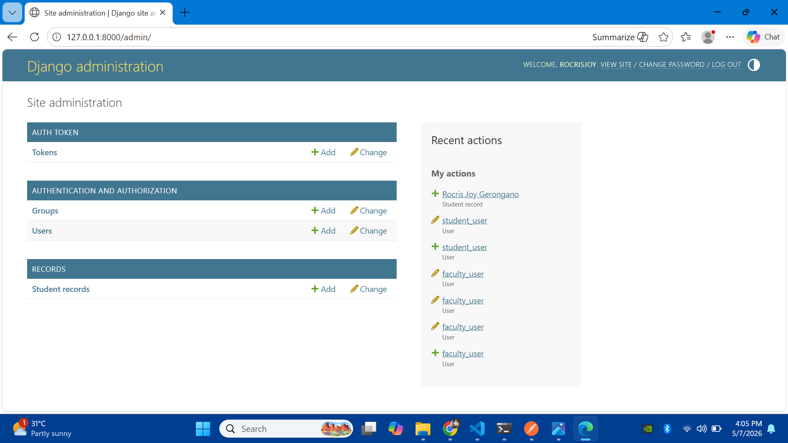

# Secure Student Records API
**Lab Activity: JWT Authentication & Role-Based Authorization**

## 📌 Project Overview
This is a backend-only REST API developed with Django. It manages student records with high security using JSON Web Tokens (JWT) and Role-Based Access Control (RBAC). There is no frontend; all interactions are performed via **Postman**.

### 🛠 Tech Stack
* **Language:** Python
* **Framework:** Django & Django REST Framework (DRF)
* **Authentication:** SimpleJWT (JSON Web Tokens)
* **Database:** SQLite
* **Testing Tool:** Postman

---

## Lab Deliverables (Screenshots)

### 1. JWT Authentication
Proof of obtaining a secure `access` and `refresh` token.


### 2. Successful Access (Authorized)
Showing a successful `200 OK` response when accessing protected data.


### 3. Denied Access (Unauthorized)
Proof of the system blocking unauthorized actions with a `403 Forbidden` status.


### 4. User & Group Configuration (Django Admin)
Proof of the `faculty_user` and `student_user` being assigned to their respective groups.


---

## 🚀 How to Run and Test

### 1. Prerequisite
Ensure you have Python installed. It is recommended to use a virtual environment.

### 2. Start the Server
Open your terminal in the project root and run:
```bash
python manage.py runserver